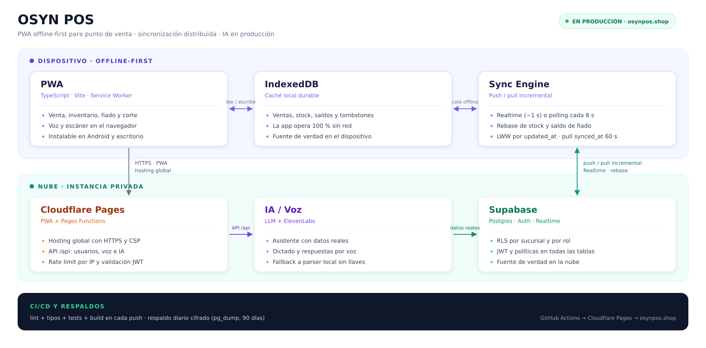
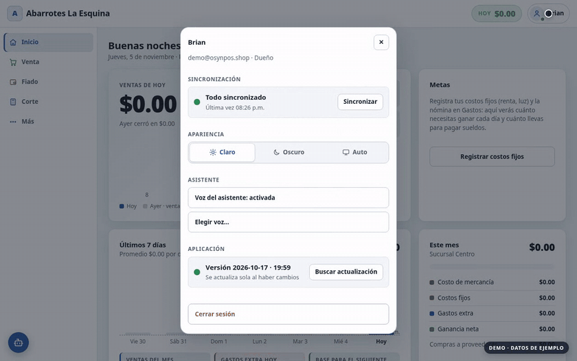

# OSYN POS

**Punto de venta offline-first** para tiendas de abarrotes: sincronización
distribuida, RLS por sucursal y asistente IA en producción.

> **Software propietario.** OSYN POS es un producto de Brian Martinez Mariscal.
> Todos los derechos reservados. Queda prohibida su reproducción, distribución,
> adaptación, sublicencia o explotación comercial sin autorización previa por
> escrito. Consulta [LICENSE](LICENSE).

**Producción:** [osynpos.shop](https://osynpos.shop)

[](https://github.com/BrianMariscal/osyn-pos/actions/workflows/ci.yml)
[](https://github.com/BrianMariscal/osyn-pos/actions/workflows/backup.yml)
[](https://github.com/BrianMariscal/osyn-pos/releases/tag/v1.0.0)

## Arquitectura



> En el dispositivo, la PWA escribe primero en IndexedDB y el Sync Engine sube
> deltas a Supabase. En la nube, Cloudflare Pages sirve la app y las funciones
> de IA/voz; GitHub Actions ejecuta CI y respaldos cifrados.

## Decisiones de arquitectura

- **Offline-first real, no un “modo offline”.** La venta se escribe primero en
  IndexedDB; el Sync Engine sube cambios incrementales y rebasa contadores
  mutables (stock y fiado) para no perder operaciones hechas sin red.
- **Instancia dedicada y RLS por sucursal.** La operación corre en una instancia
  propia de Supabase + Cloudflare. Dentro de la tienda, RLS, JWT y roles
  (dueño, admin, vendedor) limitan cada dato a su sucursal: el catálogo se
  comparte, pero stock, ventas y caja no.
- **Sincronización distribuida idempotente.** Tombstones para borrados,
  last-write-wins por `updated_at` y pull incremental por `synced_at` del
  servidor con 60 s de solape; el margen de 10 min queda solo para el fallback
  legacy por `updated_at`. Realtime baja la latencia a ~1 s; sin Realtime,
  polling cada 8 s. El orden de escritura sigue dependiendo del reloj del
  dispositivo; está documentado en
  [Límites técnicos](#límites-técnicos-conocidos).
- **IA sobre datos reales, con degradación elegante.** El asistente consulta
  ventas, caja y fiado mediante funciones serverless que validan el JWT; si no
  hay llaves de IA, un parser local mantiene la venta por voz.
- **CI/CD y respaldos desde el día uno.** GitHub Actions corre lint, tipos,
  tests y build en cada push; el workflow de respaldo diario usa `pg_dump`
  cifrado con retención de 90 días.

Los límites de estas decisiones están documentados en
[Límites técnicos conocidos](#límites-técnicos-conocidos).

## Demostración de uso



> **DEMO · DATOS DE EJEMPLO.** Grabada con el frontend y el Sync Engine reales
> y un backend Supabase simulado, para mostrar el flujo sin exponer datos
> reales de la operación. No es una captura de la instancia de producción.
>
> La secuencia corta la red, vende 3 productos ($45.00), muestra **4 cambios
> pendientes** y, al reconectar, termina en **Todo sincronizado**. En
> producción, con Realtime aplicado, la sync se dispara en ~1 s; el polling de
> respaldo es de 8 s.

## Calidad y operación

| Métrica | Valor | Cómo verificarla |
|---|---:|---|
| Pruebas automatizadas | **186** en 27 archivos | `npm test` y CI en cada push |
| Pruebas del Sync Engine | **26** en 5 archivos · simulación de 2 dispositivos | [`tests/sync-pull.test.ts`](tests/sync-pull.test.ts) · [`tests/settings-sync.test.ts`](tests/settings-sync.test.ts) |
| Tablas con RLS | **14/14** · 52 políticas | [`supabase/schema.sql`](supabase/schema.sql) |
| Sync con Realtime | **~1 s** (objetivo) | [`supabase/migracion-realtime.sql`](supabase/migracion-realtime.sql) |
| Polling de respaldo | **8 s** (60 s con Realtime activo) | [`src/ui/shell/sync.ts`](src/ui/shell/sync.ts) |
| Respaldo cifrado | workflow diario · AES-256 · **90 días** | [run verificado 2026-11-06](https://github.com/BrianMariscal/osyn-pos/actions/runs/42155052758) · [workflow](.github/workflows/backup.yml) |
| RPO de respaldo | **≤ 24 h** | verificado 2026-11-06 · ejecución diaria a las 03:15 CT |
| Producción | [osynpos.shop](https://osynpos.shop) | Cloudflare Pages |

> Las pruebas del Sync Engine cubren merge/LWW, pull incremental, rebase de
> contadores, ajustes entre dispositivos y salud del sync. El reintento de un
> push fallido está probado en [`tests/sync-pull.test.ts`](tests/sync-pull.test.ts):
> el delta se aplica una sola vez y el reintento reenvía el valor ya rebasado.
>
> Las métricas de operación (tiendas activas, ventas sincronizadas y latencia
> real medida) son información privada y no se publican en este repositorio.

## Límites técnicos conocidos

Estos son los límites asumidos y su impacto operativo.

### LWW, no CRDT

La resolución de conflictos es **last-write-wins por fila** usando `updated_at`,
con rebase por deltas para los contadores mutables (stock y saldo de fiado). No
hay CRDT.

- **Por qué:** las ventas son append-only, cada sucursal tiene su propio stock y
  la edición simultánea del mismo campo es rara. Un CRDT (Yjs, Automerge)
  habría añadido metadatos, almacenamiento y complejidad operativa para un
  problema que casi no existe en este dominio.
- **Límite:** si dos dispositivos editan el mismo campo de un producto sin red,
  gana el `updated_at` más reciente y la otra edición se descarta. Los
  contadores no se pierden porque se reaplican como delta, pero un cambio de
  precio o nombre sí puede perderse.
- **Relojes:** el pull incremental usa `synced_at` del servidor, así que una
  fila subida tarde no se pierde aunque su `updated_at` sea viejo (hay prueba
  en [`tests/sync-pull.test.ts`](tests/sync-pull.test.ts)). Pero LWW sigue
  comparando `updated_at`, que escribe el reloj del dispositivo: un equipo
  adelantado o atrasado puede ganar o perder una edición no acumulable. El
  solape de 10 min solo aplica al fallback legacy por `updated_at`; el pull
  primario usa 60 s sobre `synced_at`. La solución estructural es que el
  servidor asigne `updated_at` con un trigger y el cliente adopte ese valor;
  hoy no está implementado.
- **Mitigación:** la UI muestra pendientes y errores de sync; las ventas no
  compiten entre sí porque cada una es una fila nueva.

### Consistencia eventual, no transacciones distribuidas

Una venta se confirma localmente aunque el servidor no esté disponible. El
stock y el fiado se ajustan al sincronizar, no en el momento de la venta.

- **Por qué:** disponibilidad primero. Bloquear el cobro sin red es peor para
  una tienda que reconciliar después.
- **Límite:** dos cajas offline pueden vender la última pieza y sobrevender
  hasta que ambas sincronicen. El servidor rechaza filas que violan RLS o
  restricciones y la app avisa, pero no hay reserva anticipada de stock.
- **Reintentos:** el rebase consume el delta al aplicarlo sobre la nube; si el
  push falla y se reintenta, se reenvía el valor ya rebasado y no se vuelve a
  restar. La prueba de regresión está en
  [`tests/sync-pull.test.ts`](tests/sync-pull.test.ts) (“un reintento tras un
  push fallido no vuelve a aplicar el delta”).
- **Pendiente:** mover stock y fiado a una función RPC atómica en Postgres. Hoy
  se mitiga con rebase por deltas y guardias en la base; no es equivalente a
  una transacción distribuida.

### Instancia dedicada

La operación corre sobre un proyecto propio de Supabase y un despliegue propio
de Cloudflare. No hay una base compartida entre operaciones ni un panel central
para administrarlas.

- **Por qué:** aislamiento total con el RLS actual, sin rediseño y con riesgo de
  fuga entre operaciones prácticamente nulo.
- **Límite:** migraciones, monitoreo y respaldos se administran por instancia.
  No hay un panel central con métricas de varias operaciones.

### Tombstones sin compactación

Los borrados se propagan con `deleted = true`; no se eliminan físicamente ni
hay un job de compactación.

- **Por qué:** un tombstone es idempotente y sobrevive a dispositivos que
  estuvieron offline mucho tiempo.
- **Límite:** las tablas crecen con filas borradas y todas las consultas deben
  filtrar `deleted`. Con el volumen de una tienda no es un problema hoy; a
  mayor escala haría falta compactar después de una ventana de sync.

### Reportes calculados en el dispositivo

Los reportes y cortes se calculan en el dispositivo sobre las ventas ya
sincronizadas, no con agregaciones SQL en el servidor.

- **Por qué:** funciona offline, es simple y evita otra capa de caché.
- **Límite:** cada dispositivo descarga las tablas que necesita y agrega en
  memoria. Con muchos años de ventas o miles de sucursales habría que mover
  los reportes a vistas materializadas o RPC. Para una tienda de abarrotes con
  historial acotado, el trade-off es correcto.

### Rate limit por IP

Los endpoints de `api/` aplican un límite por IP: 20 req/min para el asistente,
40 para voz y 30 para usuarios. Si `UPSTASH_REDIS_REST_URL` y
`UPSTASH_REDIS_REST_TOKEN` están configurados, el conteo es compartido entre
instancias y sobrevive a los deploys; si no, es un `Map` en memoria por
instancia de Cloudflare Pages Functions. No hay WAF ni límite global de
Cloudflare en el repositorio, así que sin Upstash la protección es parcial.

### Cierre de caja y ventas offline

El cierre automático de medianoche no es un cron del servidor: lo ejecuta un
dispositivo con sesión de admin cada 60 s y al volver a la app; si no hay
ninguno abierto, el corte queda pendiente. El corte agrupa por `created_at` de
la venta (la hora del dispositivo que la registró), no por la hora de
sincronización. Si una venta offline se sincroniza después de que otro equipo
cerró el corte de ese periodo, el resumen guardado del corte no se recalcula:
la venta conserva su fecha y sigue en reportes, pero si su `created_at` es
anterior al `closed_at` de ese corte tampoco entra en el siguiente resumen.
Revisar esos casos es manual.

### Dependencias externas: IA y Realtime

- **IA y voz:** el asistente en la nube y la voz cloud dependen de llaves de
  terceros (LLM y ElevenLabs). Sin llaves, la app degrada a un parser local y a
  la voz del dispositivo; el POS sigue funcionando. Los resultados de IA no son
  deterministas y están sujetos a rate limit y costo.
- **Realtime:** si Supabase Realtime no está disponible, la app cae a polling
  cada 8 s. La sync sigue funcionando, pero la latencia percibida sube.

### Respaldo y durabilidad local

El respaldo es un workflow de `pg_dump` diario cifrado con AES-256 y retención
de 90 días. El primer run verificado fue el 2026-11-06; el RPO de 24 h es real
mientras el workflow siga corriendo en verde. No hay PITR configurado.

- **RPO:** hasta 24 h de datos ante un desastre. IndexedDB conserva el estado
  en cada dispositivo y se puede exportar manualmente desde Ajustes › Respaldo;
  el respaldo diario cubre el resto. Subir a PITR es una decisión de costo, no
  de código.
- **Durabilidad en el dispositivo:** la app pide almacenamiento persistente
  (`navigator.storage.persist()`), pero el navegador puede desalojarlo si el
  equipo está sin espacio, y borrar los datos del sitio elimina lo no
  sincronizado. En iOS/Safari el riesgo es mayor: el sistema puede desalojar
  el almacenamiento de una PWA que no se usa. Un dispositivo perdido antes de
  sincronizar puede perder ventas. La app muestra un aviso global cuando hay
  cambios pendientes y la última sincronización tiene más de 1 h, además del
  estado en el menú de cuenta; no sustituye un respaldo manual.

## Stack

`TypeScript` · `Vite` · `PWA` · `IndexedDB` · `Supabase (Postgres, Auth, Realtime, RLS)` · `Cloudflare Pages Functions` · `ElevenLabs` · `Vitest`

## Desarrollo

```bash
npm install
npm run dev     # http://localhost:5173
npm run check   # lint + tipos + tests
```

## Seguridad

- **RLS en todas las tablas:** cada usuario autenticado solo accede a su
  sucursal; catálogo y sucursales los administra el admin.
- **JWT validado en el servidor:** los endpoints de `api/` verifican la sesión
  contra Supabase, comprueban el rol admin cuando aplica y aplican rate limit
  por IP. Con Upstash Redis el conteo es compartido; sin él es por instancia
  (ver [Límites técnicos](#límites-técnicos-conocidos)).
- **`service_role` aislada:** vive solo como secreto en Cloudflare; nunca en el
  navegador ni en el repositorio.
- **Cabeceras estrictas en producción:** CSP, `nosniff`, `DENY` para frames y
  política de permisos para micrófono y cámara.
- **Defensa en profundidad:** guardias en la base para stock, precios,
  cantidades, fiado y devoluciones, además de respaldos cifrados diarios
  (RPO ≤ 24 h; sin PITR).

## Documentación

> Documentación interna de OSYN POS. No se autoriza su reproducción ni
> distribución a terceros.

| Guía | Contenido |
|---|---|
| [Instalación de Supabase](docs/setup-supabase.md) | Guía interna del proyecto, schema/migraciones y usuarios iniciales |
| [Despliegue](docs/deploy.md) | Operación interna en Cloudflare Pages, variables, secretos y monitoreo |
| [Respaldos](docs/respaldos.md) | Configurar, restaurar y verificar el respaldo diario |
| [CHANGELOG](CHANGELOG.md) | Historial de versiones |
| [LICENSE](LICENSE) | Términos de propiedad intelectual |

## Características

- **Venta** con buscador, escáner de código y dictado por voz ("dos cocas, una leche").
- **Venta a granel**: por peso o litros (g/kg, ml/L) o por importe ("$20 de
  jitomate") con conversión automática a dinero.
- **Devoluciones**: busca la venta por folio, elige los renglones y cantidades
  (acepta devoluciones parciales); el stock regresa al inventario y el reembolso
  se descuenta de la caja, o se abona al fiado del cliente.
- **Fiado** con clientes de la tienda, cargos, pagos (incluidos los parciales) e
  historial de movimientos.
- **Inventario** con entradas de mercancía, mermas, conteos físicos y aviso de mínimos.
- **Corte de caja** con arqueo, diferencia, historial con detalle de cada corte,
  **corte de un día pasado** (cierra pendientes sin tocar las ventas de hoy),
  **cierre automático a medianoche** si no se hizo manualmente —lo ejecuta un
  dispositivo con sesión de admin cada 60 s y al volver a la app, no un cron del
  servidor— y envío del resumen por WhatsApp a los números de la sucursal.
- **Reportes** diarios/mensuales, ganancia, y exportación a PDF.
- **Asistente por chat** que responde con datos reales (ventas, caja, fiado) y puede registrar gastos.
- **Multi-dispositivo**: PC, celular y tablet sincronizados.
- **Offline real**: cada venta se guarda en el dispositivo y se sincroniza al volver la conexión; los conflictos de stock/saldo se rebasan sin perder ventas offline.
- **Sucursales**: una por defecto; el dueño agrega más cuando quiera, cada una con su propio stock, ventas y caja (catálogo compartido). En Ajustes › Sucursales se configuran (el dueño, o el administrador en la suya) hasta dos números de WhatsApp para recibir cada corte y el cierre automático a medianoche.
- **Roles**: admin y vendedor (el admin decide qué pantallas ve cada vendedor).

## Sincronización y offline

- Todo se guarda primero en IndexedDB y después se sube/baja por tabla con
  cambios incrementales (las tablas se descargan en paralelo).
- Tiempo real: con `supabase/migracion-realtime.sql` aplicado, cada cambio en
  otro dispositivo dispara la sync en ~1 s (WebSocket de Supabase Realtime).
  Sin él, se revisa cada 8 s mientras la app está visible.
- El pull incremental usa `synced_at`, la marca que pone el servidor al
  recibir cada fila, con 60 s de solape para no saltar commits tardíos. Si la
  migración `synced_at` aún no está aplicada, cae al modo legacy por
  `updated_at` con 10 min de margen. El merge es idempotente.
- Los borrados se propagan con tombstones y el conflicto se resuelve
  last-write-wins por `updated_at` (reloj del dispositivo); ver
  [Límites técnicos](#límites-técnicos-conocidos).
- Los contadores mutables (`stock`, saldo de fiado) se protegen: si hay un
  cambio local sin subir y la nube avanzó, el delta local se aplica sobre el
  valor nuevo de la nube en lugar de perderse.

## Estructura

```
src/
  core/     tipos, dinero (centavos enteros), fechas con zona local, HTML seguro
  domain/   store reactivo + servicios (venta, fiado, inventario, corte, reportes, sucursales)
  data/     IndexedDB, cliente Supabase, sync engine incremental y rebase de contadores
  ai/       cliente del asistente
  ui/       shell, componentes (modal/toast) y una pestaña por módulo
  styles/   design system (tokens + componentes)
api/          funciones serverless (asistente, voz, usuarios) con forma req/res de Node
functions/    adaptador de Cloudflare Pages que sirve api/ en /api/*
supabase/     schema.sql, migraciones y verificacion.sql (qué protecciones tiene la base)
public/       config.js (llaves públicas), _headers (seguridad), íconos, assetlinks (Android)
tests/        pruebas de Vitest
docs/         guías internas de instalación, despliegue, respaldos y arquitectura
.github/      CI (lint, tipos, pruebas, build) y respaldo diario cifrado
```

## Propiedad intelectual

OSYN POS, su código fuente, documentación, diseño y marca son propiedad de
Brian Martinez Mariscal. Todos los derechos reservados. No se concede licencia
ni derecho de uso sobre el software o su documentación. Consulta
[LICENSE](LICENSE).
